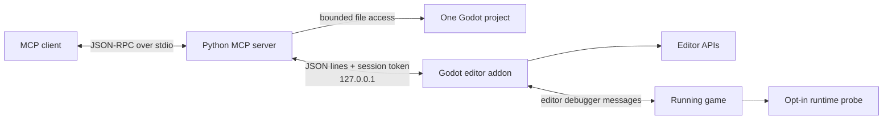

# Architecture

## Components

### Python server

The server owns the MCP lifecycle, schemas, capability filtering, path checks,
process ownership, transaction checkpoints, and conversion between MCP content
blocks and the editor bridge. It uses the Python standard library at runtime.

Each server instance resolves one directory containing `project.godot`. It does
not discover or switch to another project after startup.

### Editor addon

The addon is an `EditorPlugin` loaded by the selected Godot project. It exposes
a small JSON-line protocol on loopback, maps named operations to editor APIs,
owns live-debugger state, and keeps editor-side audit records. The protocol is
not a general GDScript evaluator.

### Runtime probe

Runtime telemetry is opt-in per scene. A scene containing `runtime_probe.gd`
sends bounded samples through the Godot editor debugger connection. The editor
validates and retains a limited window for MCP reads. Image capture is a
separate request and requires the capture permission.

### Transaction helpers

File, resource, and texture-import modules implement preview/apply/rollback
workflows. They use operating-system locks, expected SHA-256 values, temporary
files, atomic replacement where supported, persistent checkpoint manifests,
and post-write verification. Each workflow documents cases where rollback is a
compensating action rather than byte-for-byte restoration.

## Data origins

Every consumer must distinguish these sources:

| Origin | Example | Meaning |
|---|---|---|
| Disk | `.tscn`, `.gd`, `.import` | Saved project state |
| Edited scene | editor scene tree | Current editor state, possibly unsaved |
| Runtime | opt-in debugger sample | A recent game frame, possibly stale |
| Process | captured stdout/stderr | Output of a process started by this server |
| Native hook | Optional C++ extension | Capability absent from stock builds |

No one source proves the others. A saved scene hash does not prove runtime
state, a runtime tree does not prove disk state, and a headless validation does
not prove pixels presented by a GPU.

## Protocol versions

- `2025-11-25`: conventional MCP `initialize` session retained for existing
  clients.
- `2026-07-28`: request-scoped metadata and `server/discover`; no connection
  initialization state is required.

Both versions expose the same filtered tool definitions. Modern responses add
`resultType` and response metadata required by that protocol generation.

## Failure behavior

Expected conditions use structured tool errors such as `write_disabled`,
`invalid_path`, `hash_conflict`, `stale_revision`, `unavailable`, or
`transaction_busy`. Errors are returned as MCP tool results where appropriate;
they do not write protocol noise to stdout.
